# Twitch TV 2.0 — клиент Twitch для Android TV / Google TV

Неофициальный клиент Twitch для просмотра с пульта: обход рекламы, 1440p60 HEVC после входа,
автоматическое восстановление, Happ VPN, чат и диагностика — и **четыре полностью разных
интерфейса** на одном движке: Classic, Liquid Glass, Google TV и GTA VI.

- **Имя пакета (постоянное): `su.expensive.twitchtv`** — его нужно указывать в правилах Happ.
- Версия: **2.0.0 (versionCode 3)**. Android 7.0+ (minSdk 24), target SDK 35.
- APK: в [GitHub Releases](https://github.com/bbvbbvvgg/twitch-tv/releases) — `TwitchTV-2.0.0.apk`,
  подписан тем же ключом, что 1.x: ставится поверх, избранное, история, настройки и вход сохраняются.

## Четыре дизайна

Настройки → **«Дизайн интерфейса»**. Переключается сразу, без перезапуска и переустановки;
выбор сохраняется. Если идёт трансляция, она не прерывается: плеер и чат принадлежат общему
движку, а не дизайну. Избранное, история, вход и все настройки общие для всех дизайнов.

| | Главный экран | Плеер | Настройки |
|---|---|---|---|
| **Classic** — оригинальный интерфейс 1.x: вкладки и сетка карточек | 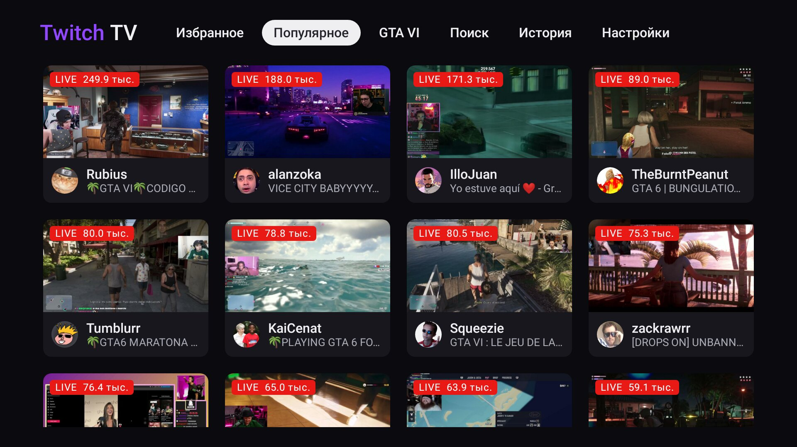 | 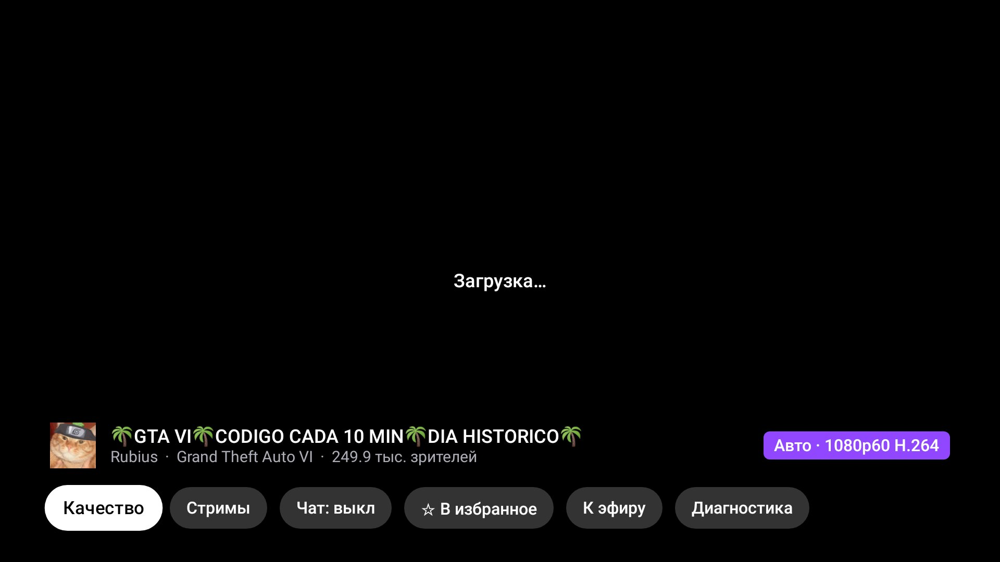 | 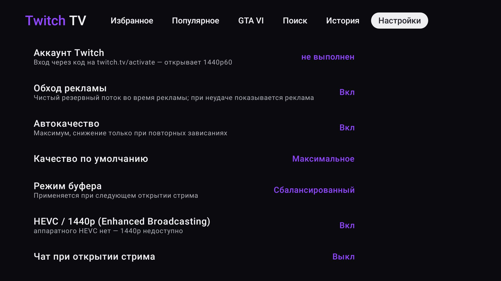 |
| **Liquid Glass** — плавающий док, огромное превью с описанием, полка плиток, фон из размытого кадра, стеклянные панели | 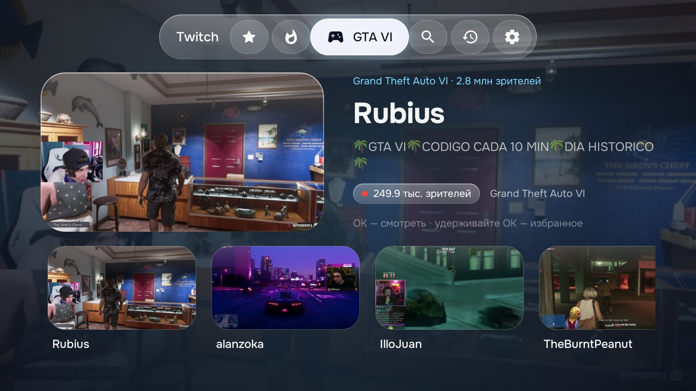 | 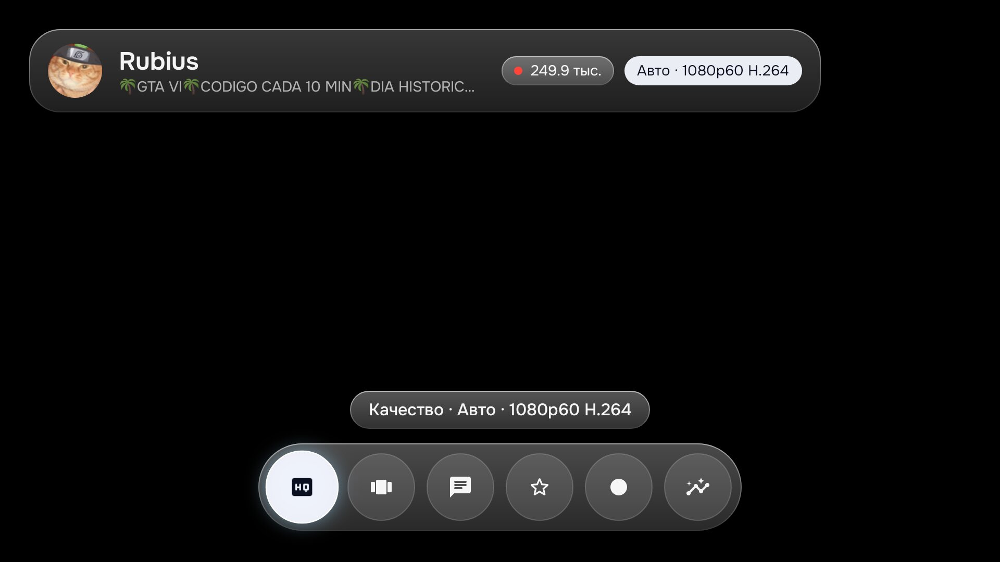 | 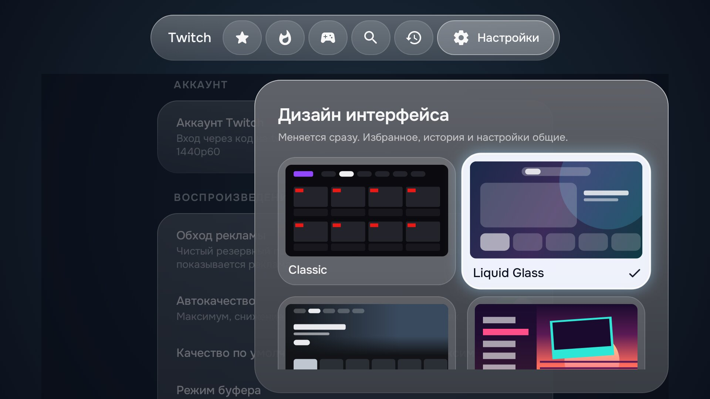 |
| **Google TV** — баннер «Для вас» с ротацией, карусели (продолжить, избранные каналы, популярное, GTA VI, рекомендации по вашим играм), двухпанельные настройки | 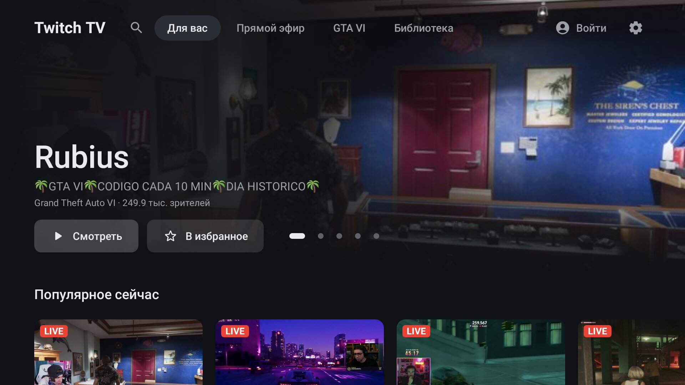 | 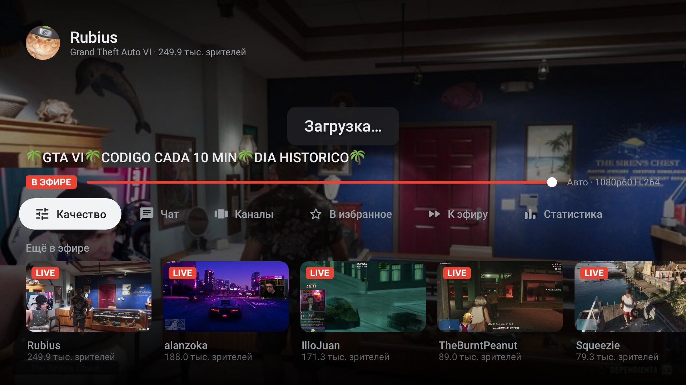 | 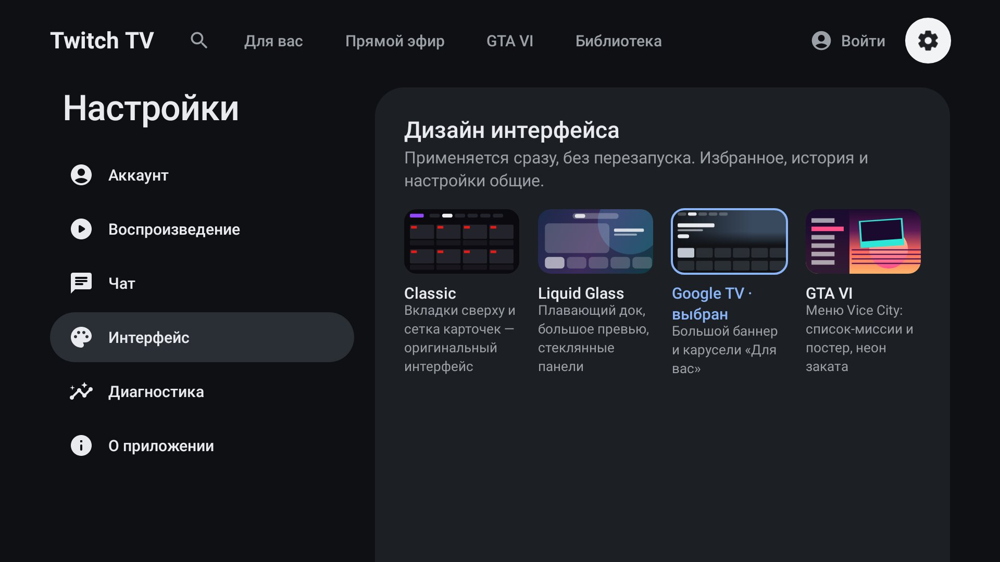 |
| **GTA VI** — меню паузы в стиле Vice City: закат, неон, нумерованный список-«миссии» и открытка-постер; качество — «радио», каналы — «телефон» | 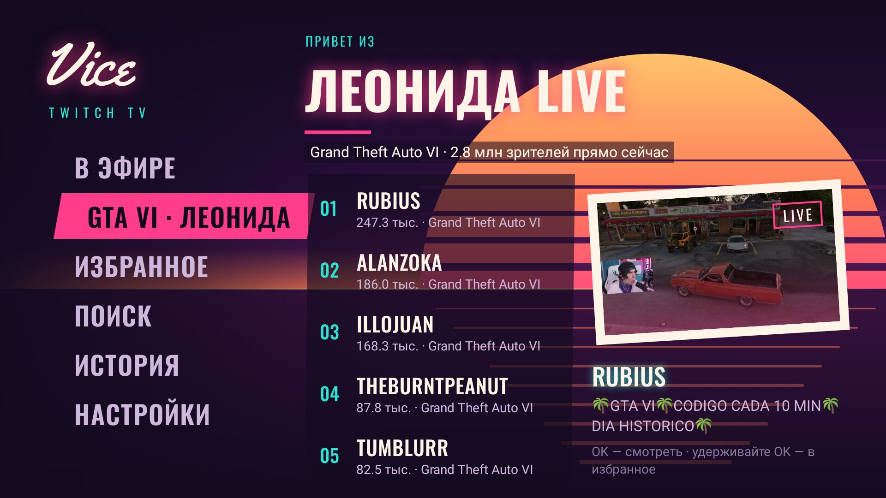 | 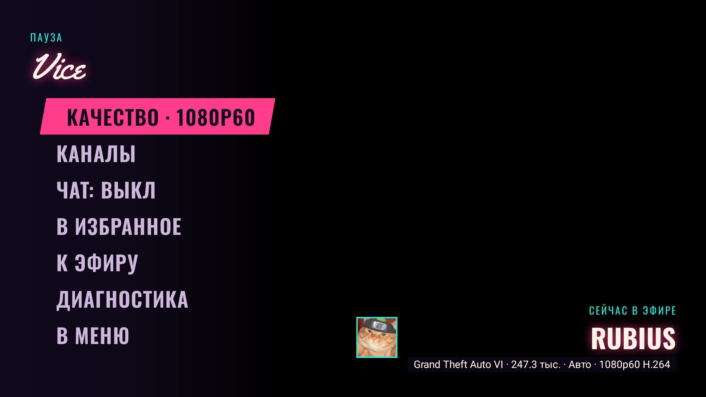 | 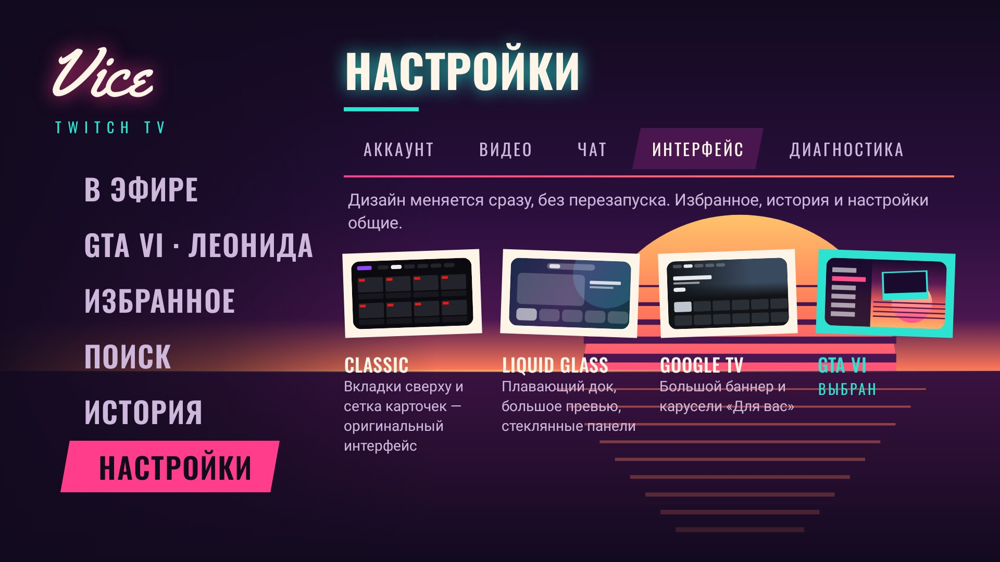 |

Это не перекраска: у каждого дизайна свои навигация, компоновка, фокус, панели плеера, выбор
качества, переключение каналов, чат и экран настроек — сравнение в [DESIGN.md](DESIGN.md).
Документы: [Classic](docs/design/classic.md) · [Liquid Glass](docs/design/liquid-glass.md) ·
[Google TV](docs/design/google-tv.md) · [GTA VI](docs/design/gta-vi.md) · [архитектура](docs/ARCHITECTURE.md) ·
[как сделаны скриншоты](docs/SCREENSHOTS.md).

Скриншоты — реальный рендер приложения (Robolectric Native Graphics, живые данные Twitch,
1920×1080), **не** снимки с телевизора и не эмулятор: в этой среде нет видеодекодера, поэтому
в плеере вместо видео — чёрный кадр/превью и «Загрузка…». GTA VI-дизайн — оригинальная графика,
нарисованная кодом; логотипов, скриншотов и шрифтов Rockstar нет.

## Установка на TCL Google TV

1. На ТВ: Настройки → Система → Об устройстве → 7 раз нажать «Сборка ОС Android TV» (режим разработчика).
2. Вариант А (без ПК): установить «Send Files to TV» или «Downloader», передать APK, открыть его,
   разрешить «Установка неизвестных приложений» для этого файлового менеджера.
3. Вариант Б (ADB по сети): Настройки → Система → Для разработчиков → «Отладка по сети»
   (или «Отладка по USB»), затем на ПК:
   ```
   adb connect <IP-телевизора>:5555
   adb install -r TwitchTV-2.0.0.apk
   ```
4. Приложение появится в строке приложений Google TV (баннер «Twitch TV»).

Обновления: новую версию ставить поверх (`adb install -r`). Это работает только если APK
подписан **тем же ключом**. Ключ хранится у сборщика и в архив исходников не входит.

## Happ Proxy (выборочная маршрутизация)

Приложение не содержит своего VPN/прокси и не меняет сетевые настройки. Все запросы идут
через сеть Android по умолчанию для этого приложения. Если Happ применяет к нему VPN, трафик
попадает в туннель Happ, а дальше Happ сам решает, пустить ли домен через прокси или напрямую.

- Если в Happ включён режим «только выбранные приложения» — добавьте **`su.expensive.twitchtv`**
  в список приложений, идущих через VPN.
- Если режим «все, кроме выбранных» — убедитесь, что пакета нет в исключениях.
- Используемые домены (для маршрутизации по доменам): `gql.twitch.tv`, `usher.ttvnw.net`,
  `*.ttvnw.net` / `*.hls.ttvnw.net` / `*.cloudfront.hls.ttvnw.net` / `*.live-video.net` (видео-сегменты),
  `static-cdn.jtvnw.net` (превью), `irc-ws.chat.twitch.tv` (чат),
  `7tv.io`, `cdn.7tv.app`, `api.betterttv.net`, `cdn.betterttv.net`,
  `cdn.frankerfacez.com` (эмоуты, только если включены; FFZ-список берётся из кэша BTTV).
- Проверка: Плеер → «Диагностика» показывает две отдельные строки.
  - **«VPN-интерфейс у приложения: да/нет»**: у сети по умолчанию *этого приложения* есть
    `TRANSPORT_VPN` (Android считает это для каждого приложения отдельно, поэтому правила Happ
    по приложениям учитываются). Это **не доказывает**, что Twitch идёт через прокси: правила
    Happ по доменам или GeoIP могут отправить эти домены напрямую.
  - **«Страна по данным Twitch (usher)»**: `USER-COUNTRY` из ответа `usher.ttvnw.net`, то есть
    страна, с которой Twitch на самом деле видит запрос. Это реальное измерение, но только для
    запроса к usher. Видео-сегменты идут на другие домены (CDN). Если правила Happ для них
    отличаются, сегменты могут идти другим маршрутом, и приложение не может это проверить.
  - IP-адрес, который возвращает Twitch, в интерфейсе не показывается и в лог не попадает.
  При смене сети или перезапуске Happ плеер переподключается автоматически.

## Управление пультом

Во всех дизайнах одинаковые разделы (Избранное, Популярное, GTA VI, Поиск, История,
Настройки) и одинаковые кнопки:

| Кнопка | Главный экран | Плеер |
|---|---|---|
| Стрелки | навигация | открыть панель управления |
| OK | открыть стрим | открыть панель / выбрать |
| Долгое OK | добавить/убрать из избранного | — |
| Back | на уровень выше (в GTA VI — сначала в меню) / выход | закрыть окно → панель → выход из плеера |
| CH+ / CH− | — | следующий / предыдущий стрим списка |
| Play/Pause | — | вернуться к прямому эфиру |

В плеере любой дизайн даёт: Качество, Каналы, Чат, Избранное, К эфиру, Диагностика, Экспорт
лога — но выглядят и устроены они по-своему (см. таблицу в DESIGN.md).

## Качество

- По умолчанию — максимальное доступное (source, обычно 1080p60).
- **1440p60 / HEVC / AV1** (Twitch Enhanced Broadcasting) запрашиваются только если на ТВ есть
  **аппаратный** декодер HEVC/AV1 (проверка через `MediaCodecList`, программные декодеры
  исключены). Статус показан в «Настройки → HEVC / 1440p». При ошибке декодера плеер сам
  откатывается на H.264 того же качества.
- Автокачество: старт с максимума; снижение на одну ступень только при повторных зависаниях
  (2 ребуфера за 60 с или одно зависание дольше 5 с); попытка вернуть качество — после
  3 минут стабильной работы. Ручной выбор в панели отключает автоснижение до конца сеанса.
- Режимы буфера: Низкая задержка (≈3 с) / Сбалансированный (≈7 с, по умолчанию) / Стабильный (≈14 с).
  Для слабого канала через VPN выбирайте «Стабильный».

## Обход рекламы

Включён по умолчанию, отключается в Настройках.

1. Основной поток запрашивается с `playerType=popout` (как `ForceAccessTokenPlayerType` в VAFT).
2. Каждое обновление media-плейлиста проверяется на вставки (`stitched`/`EXT-X-DATERANGE`,
   сегменты без метки `live`). Найденные рекламные сегменты вырезаются, корректируются
   `MEDIA-SEQUENCE` и `EXT-X-MAP` (fMP4).
3. Если реклама есть — параллельно берётся резервный токен: `embed` → `popout` (новый device id)
   → `autoplay` (360p). Плеер переключается на первый чистый.
4. Каждые 4 с проверяется основной поток; после 2 чистых опросов подряд — возврат на основное качество.
5. Если чистого потока нет — показывается реклама Twitch (стабильность важнее).

Эффективность зависит от Twitch и может меняться в любой момент; в диагностике видно
число вырезанных сегментов и текущий источник.

## Чат

Анонимный read-only IRC (`justinfan…`) — без OAuth и аккаунта. Включается в панели плеера или
по умолчанию в Настройках. Эмоуты 7TV/BTTV/FFZ — опционально.

## Диагностика

Только измеряемые значения: разрешение и кодек, имя декодера, FPS потока и фактический FPS
рендеринга, пропущенные кадры, буфер, отставание от эфира, оценка пропускной способности,
фактический битрейт по загруженным сегментам, переподключения, ребуферы, последняя ошибка,
реклама, источник, VPN-интерфейс, страна по данным Twitch. Значения, которые нельзя измерить, не показываются.

Экспорт лога: Настройки или панель плеера → файл `Download/twitchtv-diag-*.txt`. Из лога
удаляются токены, подписи, `sig`/`token`-параметры и полные URL сегментов.

## Конфиденциальность

Нет аналитики и трекеров. Вход в Twitch необязателен (нужен только для 1440p60); токен
шифруется ключом Android Keystore и не попадает в логи.
TLS-проверка не отключается, cleartext-трафик запрещён. Избранное, история и настройки
хранятся только локально.

## Сборка из исходников

Требуется JDK 17 и Android SDK (platform 35, build-tools 35.0.0).

```
./gradlew assembleDebug                  # debug APK
TV_STORE_PASS=... ./gradlew assembleRelease  # нужен keystore/twitchtv.jks
./gradlew testDebugUnitTest              # офлайн-тесты
./gradlew testDebugUnitTest -Dlive=true  # + тесты против живого Twitch и UI-смоук (Robolectric)
./gradlew testDebugUnitTest --tests '*DesignScreenshots*' -Dshots=true -Dlive=true  # 4 дизайна: скриншоты, D-pad, переключение
```

Структура: `data/` (GQL API, HLS-парсер и фильтр рекламы, настройки), `player/` (ExoPlayer,
восстановление, обход рекламы, диагностика), `chat/`, `ui/core` (общее состояние, сессия плеера,
списки, настройки как данные), `ui/classic`, `ui/glass`, `ui/gtv`, `ui/vice` (Compose for TV).

Шрифты: Onest и Oswald (SIL OFL 1.1), Yellowtail (Apache 2.0) — лицензии в `docs/licenses/`.
Дизайн-процесс: [Impeccable](https://github.com/pbakaus/impeccable) — PRODUCT.md, DESIGN.md, ревью в `docs/design/reviews.md`.

Идеи по получению потока основаны на изучении SmartTwitchTV (GPL-3.0) и TwitchAdSolutions/VAFT;
код написан заново. Приложение не аффилировано с Twitch.

## Вход в Twitch и 1440p60 (с 1.1)

- Twitch отдаёт рендишены выше 1080p (на recrent — «1440p60 (source)», 2560×1440, HEVC Main L5.0) только вошедшим зрителям и только если в `supported_codecs` есть `h265`. Без входа максимум 1080p60 (транскод) при любом playerType.
- Вход: Настройки → «Аккаунт Twitch» → код на twitch.tv/activate (OAuth Device Code Flow). Пароль вводится только на сайте Twitch, cookies браузера не используются.
- Client-ID: GQL принимает только first-party Client-ID Twitch, а токен действует только со своим Client-ID. Поэтому токен от своего приложения на dev.twitch.tv для PlaybackAccessToken не подходит; используется Client-ID официального Android TV приложения Twitch. Это неофициальное использование API (серая зона правил Twitch).
- Токен: AES-256-GCM, ключ в Android Keystore, allowBackup=false; refresh/validate по правилам Twitch; выход отзывает токен. В DiagLog токены, refresh_token и device_code вырезаются (тесты).
- Авторизован только основной токен; резервные потоки для обхода рекламы анонимные (≤1080p60), после рекламы — возврат к 1440p.
- playerType: с входом 1440p есть и у popout, и у site, и у embed; если popout его не отдаст — автоматически берётся site.
- Откат на 1080p60 до конца сеанса: ошибка декодера, ≥30 пропущенных кадров за 10 с, или вывод <80 % fps 15 с подряд (после 5 с прогрева).
- В диагностике: «Источник … (вход: <логин>)» и «Usher предложил: …» — список рендишенов до фильтрации.
